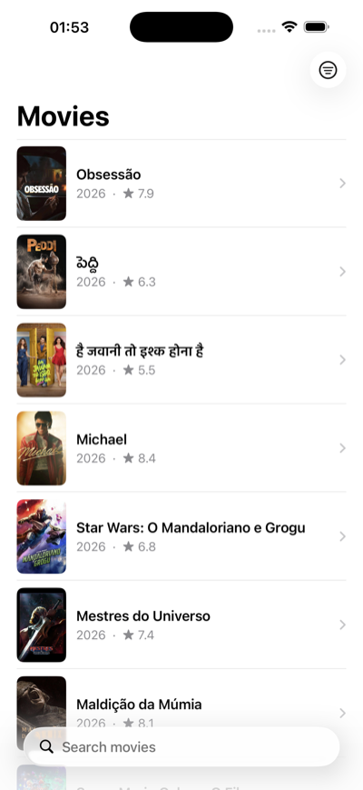
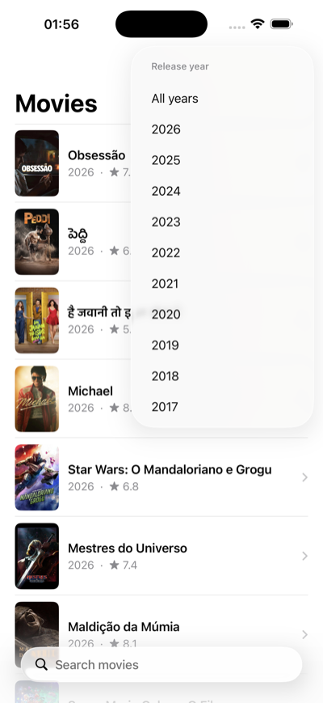
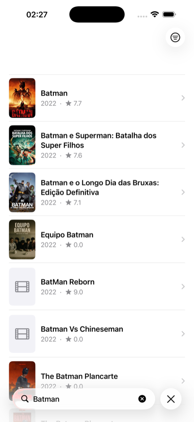
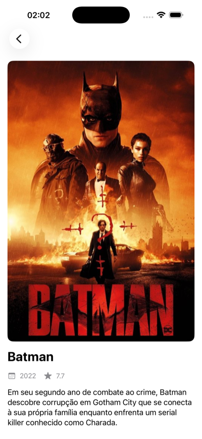

# CaseVendee

[](https://developer.apple.com/ios/)
[](https://swift.org)
[](https://developer.apple.com/documentation/uikit)
[](#architecture)

iOS app written in UIKit with view code that consumes the [TMDb API](https://www.themoviedb.org). The main screen lists popular movies with text search and a release-year filter. Tapping a movie opens a detail screen with poster, year, rating and overview.

## Screenshots

| Popular movies | Year filter | Search | Detail |
| --- | --- | --- | --- |
|  |  |  |  |

## Requirements

- Xcode 26 or later
- iOS 26 or later
- A free [TMDb account](https://www.themoviedb.org/signup) to generate an API token

## Getting Started

**1. Clone the repository**

```bash
git clone https://github.com/EnzoFerroni/CaseVendee.git
cd CaseVendee
```

**2. Add your TMDb token**

The token is kept out of version control. Create `CaseVendee/Secrets.xcconfig` with your own token (themoviedb.org → Settings → API → "API Read Access Token"):

```
TMDB_ACCESS_TOKEN = your_token_here
```

Then open `CaseVendee.xcodeproj`, go to the project settings, Info, Configurations, and set `Secrets` as the configuration file for both Debug and Release.

**3. Run**

Select an iOS Simulator and press Run. No package resolution or extra setup is needed.

## Architecture

The app follows **MVVM**. The view controller only builds the layout and forwards user events. All state and logic live in the view model, and networking in a dedicated service layer.

```
CaseVendee/
├── App/             AppDelegate, SceneDelegate
├── Models/          Movie, MovieResponse
├── Services/        MovieService, ImageLoader
├── ViewModels/      MovieListViewModel
├── Views/           MovieCell, PosterImageView
└── Controllers/     MovieListViewController, MovieDetailViewController
CaseVendeeTests/     MovieTests, MovieListViewModelTests
```

The view model notifies the view through two closures (`onMoviesUpdated`, `onError`), with no third-party framework needed.

## Technical Decisions

**View code**

Every layout is built with Auto Layout in code. The window is created programmatically in `SceneDelegate` and no storyboard files are used.

**`final class`**

All classes are marked `final` because none are designed to be subclassed. This enables direct dispatch instead of dynamic dispatch on every method call, and makes the intent clear to anyone reading the code.

**Retain cycles and `[weak self]`**

`[weak self]` is used in every closure that captures the view controller, specifically in the view model bindings and in the year filter menu actions. Without it, the view model would hold a strong reference back to the view controller, keeping it alive after the screen closes.

**Poster cache with `NSCache`**

`ImageLoader` keeps downloaded posters in an `NSCache`. Unlike a dictionary, `NSCache` is automatically purged by the system under memory pressure, so there is no need for manual eviction logic.

**Cell reuse and download cancellation**

`UITableViewCell` instances are recycled as the user scrolls. `PosterImageView` holds a reference to its active download `Task` and cancels it in `prepareForReuse`, preventing a recycled cell from briefly showing the poster of the previous movie.

**`@MainActor`**

`MovieListViewModel` is annotated with `@MainActor` so every property update and closure callback is guaranteed to run on the main thread, which UIKit requires for all UI updates.

**`async/await` networking**

All TMDb requests use `URLSession` with `async/await`. Each call is wrapped in a `Task` so it can be triggered from synchronous UIKit code. Errors are caught and forwarded to the view through the `onError` closure.

**API token via `Secrets.xcconfig`**

The TMDb token is injected at build time through a gitignored `.xcconfig` file. At runtime, `Secrets.swift` reads it from `Bundle.main.infoDictionary`, keeping the key out of version control.

**Unit tests with a fake service**

The view model receives its service through the small `MovieFetching` protocol. The tests inject a mock that returns fixed movies, so the model logic and its callbacks are verified without touching the network. The `Movie` computed properties and the TMDb JSON decoding are also covered. Run with **Cmd+U**.

**Loading and empty states**

The view model exposes an `onLoadingChanged` closure that drives a spinner during requests, and the list shows a "No movies found" message when a search returns nothing.

**Dynamic Type**

All labels use scalable fonts with `adjustsFontForContentSizeCategory`, so the app respects the text size chosen by the user in Settings.

**Pagination left out on purpose**

TMDb responses are paginated, but the app intentionally shows only the first page (20 movies) to keep the code minimal. Adding infinite scroll would mean tracking the current page in the view model and triggering a fetch from `willDisplay`.

## License

Released under the [MIT License](LICENSE). Copyright (c) 2026 Enzo Ferroni. Movie data and images are provided by [TMDb](https://www.themoviedb.org); this product uses the TMDb API but is not endorsed or certified by TMDb.
